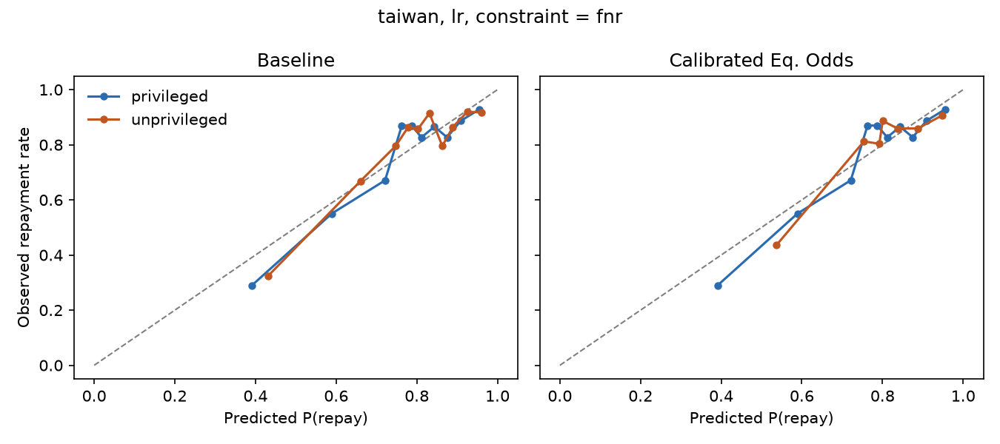

# Fairness vs calibration in credit default models

What does a fairness constraint cost a lender that needs calibrated default probabilities?

This project applies **Calibrated Equalized Odds** (Pleiss, Raghavan, Wu, Kleinberg & Weinberger, [*On Fairness and Calibration*](https://papers.nips.cc/paper/2017/file/b8b9c74ac526fffbeb2d39ab038d1cd7-Paper.pdf), NeurIPS 2017) to three credit default datasets. It measures fairness, predictive performance and the lender's view (approval and default rates per group) before and after mitigation, and checks when the method can work at all.

**Start here: [`notebooks/pipeline.ipynb`](notebooks/pipeline.ipynb)** runs everything and shows every table and plot, with outputs saved.

## Key findings

- **The method only does what it promises when the paper's feasibility condition holds.** On Taiwan it does: the gap it targets (how often repayers are doubted, per sex) closes to zero. The price is in the other error: approval of women rises from 78% to 90% and the default rate among approved women from 12.9% to 17.8%.
- **When the condition fails, decisions become group-level coin flips.** On German Credit the scores of every applicant over 25 are replaced by one base rate, so in each split either all of them are approved or none are, depending only on where the cutoff falls.
- **On Home Credit the method's own assumption breaks.** The model's cost for women sits within 0.001 of the cost of predicting the same score for every woman. AIF360 then divides by a number close to zero, and the sign of that number decides whether nobody or everybody in the group is replaced.
- **Demographic parity is not what this method improves.** DIR moves away from 1 on Taiwan and Home Credit and swings between seeds on German.



*Taiwan, seed 0: calibration per group before (left) and after (right). The method keeps scores calibrated while equalising one error rate.*

## Why it matters

Credit scoring is classed as a high-risk use of AI under the EU AI Act, and lenders rely on calibrated probabilities of default for pricing and capital. A fairness fix that silently breaks calibration, or one that replaces individual assessment with a group average, is hard to defend to a regulator or a model validation team. This project makes those trade-offs measurable.

## Method in one paragraph

Train a classifier that outputs calibrated scores. For each group, compute a generalised error rate (mean score given to defaulters, or mean of 1 − score given to repayers). The group with the lower error is moved up to match the other: for a random share α of that group, the model's score is replaced by the group's base rate. A constant base rate is itself calibrated, so calibration survives while one error rate is equalised. This only works if the other group's error is at most the error of that constant classifier (the feasibility condition). The post-processor is fitted on a validation set and applied to the test set.

## Results

Logistic regression, `fnr` constraint, 5 random splits; test-set means. Per-seed results are in the notebook (Section 5) and `figures/per_seed_lr_fnr.csv`, and they matter: on German and Home Credit the mean hides two very different outcomes.

| Dataset | DIR labels | DIR before → after | Balanced acc. before → after | Targeted gap (gen. FNR) before → after | Other gap (gen. FPR) before → after | Feasible |
|---|---|---|---|---|---|---|
| German | 0.79 | 0.74 → 0.48* | 0.70 → 0.54 | 0.101 → 0.044 | −0.006 → −0.228 | no |
| Taiwan | 1.04 | 1.04 → 1.21 | 0.69 → 0.63 | −0.013 → −0.000 | 0.017 → 0.086 | yes |
| Home Credit | 1.04 | 1.16 → 1.38 | 0.68 → 0.64 | −0.013 → −0.014 | 0.019 → 0.046 | assumption broken |

\* Mean over 3 of 5 splits; in the other two no applicant over 25 was approved, so DIR is undefined. After mitigation German's DP_Diff ranges from −0.61 to +0.53 across splits, so its mean is not meaningful.

## Datasets

| Name | Source | Rows | Label (1 = favourable) | Protected attribute |
|---|---|---|---|---|
| `german` | UCI Statlog German Credit | 1,000 | good credit risk | age (> 25 privileged) |
| `taiwan` | UCI Default of Credit Card Clients | 30,000 | no default next month | sex (male privileged) |
| `homecredit` | Kaggle Home Credit Default Risk, `application_train.csv` | 307,507 | loan repaid | sex (male privileged) |
| `synthetic` | generated in code | 4,000 | toy | toy |

Download the raw files into `data/raw/` (see `data/raw/README.md`). They are not committed: Home Credit's competition rules do not allow redistribution.

## Setup

Tested with Python 3.13 and 3.14.

```bash
python -m venv .venv && source .venv/bin/activate   # Windows: .venv\Scripts\activate
pip install -r requirements.txt
python -m pytest -q tests                            # runs on synthetic data, no downloads needed
```

## Running

The notebook runs the main configuration. Single configurations from the command line:

```bash
python run.py --dataset german     --model lr  --constraint fnr --seeds 5
python run.py --dataset taiwan     --model gbm --constraint fpr --seeds 5
python run.py --dataset homecredit --model lr  --constraint fnr --seeds 5
```

| Flag | Values | Meaning |
|---|---|---|
| `--dataset` | `german`, `taiwan`, `homecredit`, `synthetic` | which dataset |
| `--model` | `lr` (logistic regression), `gbm` (gradient boosting with isotonic calibration) | base classifier |
| `--constraint` | `fnr`, `fpr`, `weighted` | which generalised error rate to equalise |
| `--seeds` | integer, default 5 | number of random stratified splits |
| `--out` | folder, default `results` | where outputs go |

Each run writes `*_labels.csv`, `*_runs.csv` (every split), `*_summary.csv` (mean, std and count per stage) and `*_reliability.png` to `results/`.

## Pipeline

1. Load data; encode label as 1 = favourable and protected attribute as 1 = privileged.
2. Compute DP_Diff, DIR and consistency on the original labels.
3. Stratified split on label × group: 60% train, 20% validation, 20% test.
4. Train the base classifier on the training split. Missing values are imputed inside the model, with medians learned on the training split only.
5. Choose the decision cutoff on the validation set by maximising TPR − FPR (Youden's J). A fixed 0.5 cutoff approves almost everyone on imbalanced credit data.
6. Fit Calibrated Equalized Odds on validation scores; record the feasibility condition and the mixing rate per group. Apply it to the test scores.
7. On test: DP_Diff, DIR, consistency, accuracy, balanced accuracy, AUC, generalised error gaps, calibration error per group, and approval and default rates per group, for baseline and mitigated predictions.
8. Repeat over 5 splits.

## Metric definitions

- **DP_Diff** = P(ŷ = 1 | unprivileged) − P(ŷ = 1 | privileged); fair at 0.
- **DIR** = P(ŷ = 1 | unprivileged) / P(ŷ = 1 | privileged); fair at 1, acceptable 0.8 to 1.25.
- **Generalised FNR / FPR gap**: the error rates the method equalises, computed from scores: mean of (1 − score) over repayers, and mean score over defaulters, per group (unprivileged minus privileged).
- **Consistency** = 1 − mean |ŷᵢ − mean ŷ of i's 5 nearest neighbours|, on standardised features. Above 20,000 rows a fixed random subsample is used. Prediction consistency is measured on the test set; the label consistency on the same test rows is reported next to it as the like-for-like reference.
- **ECE** (expected calibration error) per group: weighted mean gap between predicted and observed repayment rate over 10 score bins.

## Limitations

- **Small test sets on German** (200 people) make its results vary strongly between splits; the per-split table is more informative than the means.
- **Hard cutoff on top of a probabilistic method.** The paper's guarantees are about scores. Lenders decide with a cutoff, and that cutoff is what turns base-rate replacement into all-or-nothing approvals.
- **The cutoff treats both errors equally.** Youden's J weighs a rejected repayer the same as an approved defaulter. A cost-based cutoff (margin versus loss given default) is the natural next step and would change the fairness numbers.
- **Only one protected attribute at a time**, and proxies stay in the data (German's `personal_status` still encodes sex).
- **Logistic regression is the main model.** Gradient boosting with isotonic calibration (`--model gbm`) shows the same patterns.

## Next steps

- Cost-based cutoff from a lender's margin and loss given default.
- Compare with an in-processing method (adversarial debiasing) on Home Credit.
- Test for proxy leakage of the protected attribute.

## License

MIT, see [LICENSE](LICENSE).
